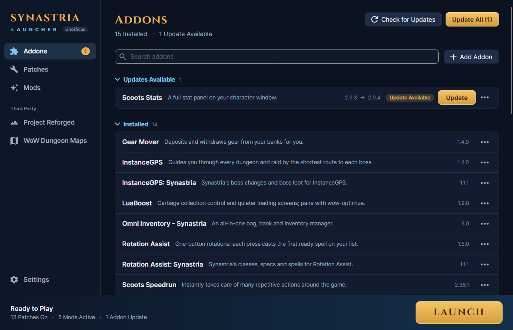
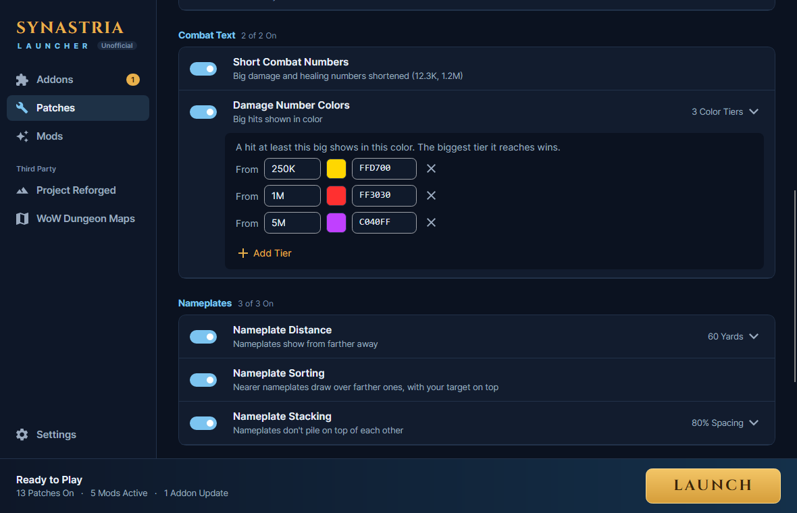
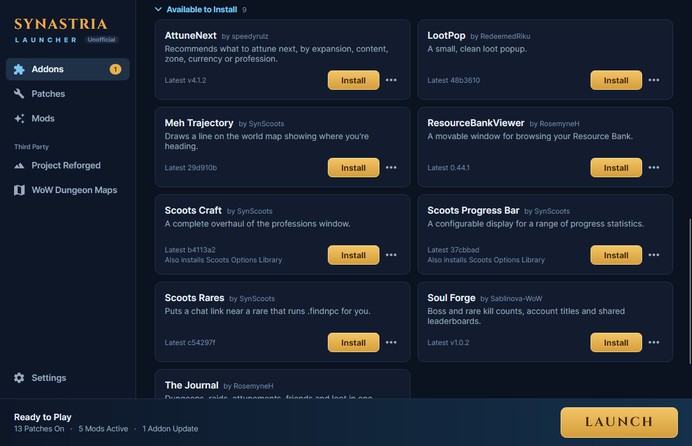
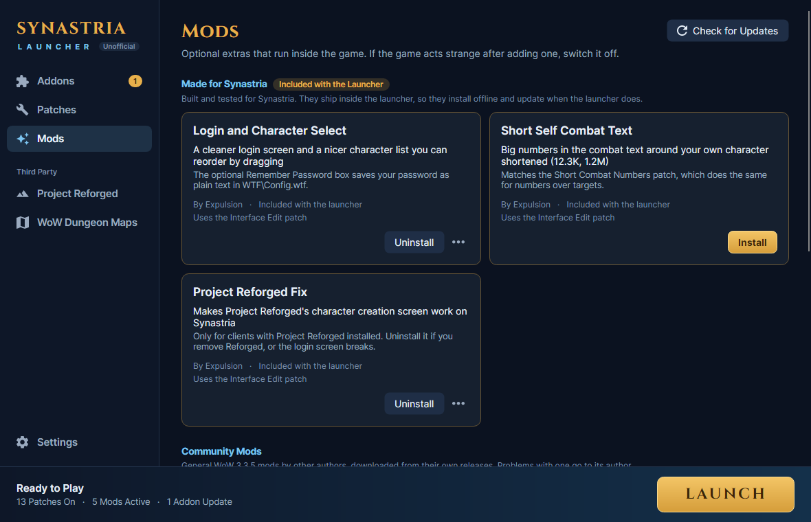
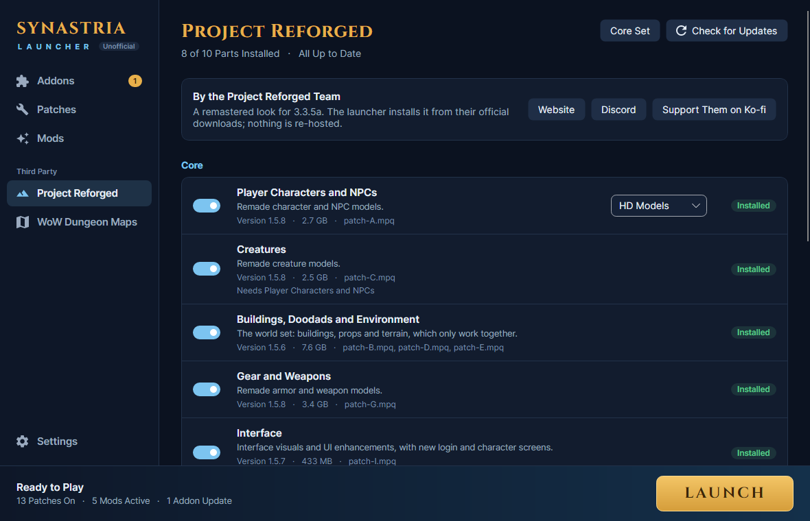
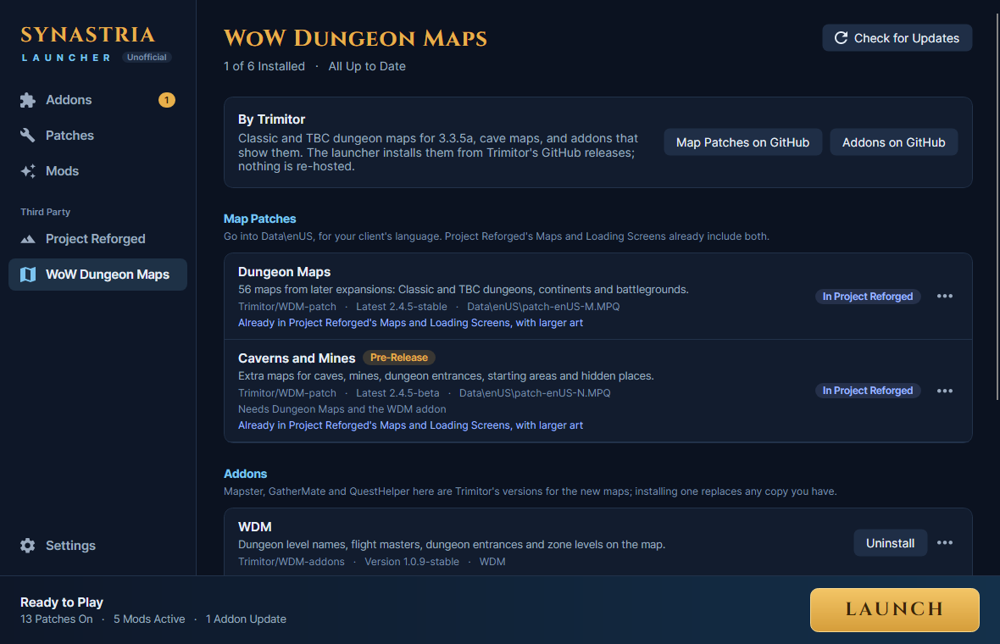

# Synastria Launcher

An unofficial launcher for Synastria WoW. It improves the game client with patches, keeps your addons up to date,
installs optional mods, and handles Project Reforged and WoW Dungeon Maps, all from one window. It's made by players,
not by Synastria's team.


## Download

Get `SynastriaLauncher.exe` from the [latest release](https://github.com/iExpulsion/SynastriaLauncher/releases/latest).
It's a single file with nothing to install: put it in a folder of its own and run it. It needs 64-bit Windows 10 or 11.

The first time you run it, Windows may show "Windows protected your PC", because the launcher isn't from a big
publisher. Choose **More info**, then **Run anyway**.

## Getting Started

1. **Find your game.** The launcher looks for your Synastria folder (the one with `WowExt.exe` in it). If it doesn't
   find it, go to **Settings**, then **Game Folder**, and choose it.
2. **Pick your patches.** On **Patches**, press **Recommended Setup**, then **Apply Changes**. Close the game first.
3. **Get some addons.** On **Addons**, install any you like from the list.
4. **Press Launch.**

Everything the launcher changes can be undone, and nothing changes until you press Apply, Install or Update.

## What It Does

### Launch

The Launch button starts the game. The bar beside it shows how many patches and mods are on and whether any addons
have updates, and it warns you about anything that needs attention, such as a mod whose patch is switched off.

### Patches

Improvements to the game client, each with its own switch:

| Patch | What it does |
|---|---|
| No Auto AFK | You're no longer marked AFK or logged out for sitting idle. |
| No Mail Refresh Delay | The mailbox refreshes right away instead of every 60 seconds. |
| Ground Target Macros | Macros can drop ground spells at your cursor, on yourself or on your target (see below). |
| Graphics Limits | Higher limits on the video settings sliders: view distance, ground clutter and more. |
| No Zoom Transparency | Your character doesn't turn see-through when the camera is zoomed in close. |
| HD Portraits | Sharper character portraits on unit frames. |
| Short Combat Numbers | Big damage and healing numbers over targets are shortened (12.3K, 1.2M). |
| Damage Number Colors | Big hits show in color. You pick up to 10 tiers, such as gold from 250K and red from 1M. |
| Nameplate Distance | Nameplates show from farther away (you choose how far, up to 100 yards). |
| Nameplate Sorting | Nearer nameplates draw over farther ones, with your target always on top. |
| Nameplate Stacking | Nameplates move apart instead of piling on top of each other. |
| Interface Edit | Lets the game load modified interface files, which some mods need. |



Changes take effect the next time you start the game. Your `WowExt.exe` only gets a small loader; everything else
is applied as the game starts, and the original exe is kept as `WowExt.exe.bak`. To go back to it, use the **…**
menu on Patches and choose **Restore Original Game**.

**Ground Target Macros** adds three targets to `/cast` macros, each with a short form for long macros:

| Target | Short form | Where the spell lands |
|---|---|---|
| `@cursor` | `@cur` | the ground under your mouse |
| `@playerlocation` | `@ploc` | where you stand |
| `@targetlocation` | `@tloc` | where your target stands |

For example, `/cast [@cur] Flamestrike` or `/cast [@tloc] Death and Decay`. This patch is still marked Experimental;
if anything acts strange, switch it off.

### Addons

A list of Synastria addons from the community, each with a short description. Install one with a click, and the
launcher keeps it up to date. Anything an addon needs, such as a shared library, is installed along with it. The
list itself is kept up to date too, so new addons show up without a launcher update.



- **Add your own:** press **Add Addon** and type any GitHub addon as `owner/repo`, or paste its link.
- **Update All** updates everything at once. Press **Check for Updates** to look again.
- **Your changes are safe:** if you've edited an addon's files, the launcher asks before updating over them. To keep
  your own version for good, choose **Hold Updates** in its **…** menu.
- **Hide** addons you'll never want from the list, and fold away any section you don't need.
- **Linked folders are left alone:** an addon folder that's linked to a folder somewhere else (for example, shared
  between two game installs) is listed under **Linked Folders** and never updated, replaced or removed.

You don't need a GitHub account.

### Mods

Optional extras that run inside the game:

- **Made for Synastria**, included with the launcher:
  - **Login and Character Select:** a cleaner login screen and a character list you can reorder by dragging.
  - **Short Self Combat Text:** big numbers around your own character shortened, like Short Combat Numbers.
  - **Project Reforged Fix:** makes Project Reforged's character creation screen work on Synastria.
- **Community mods**, downloaded from their authors' own releases:
  - **DXVK:** runs the game's graphics through Vulkan, usually smoother on modern graphics cards.
  - **Lexara:** sharper, cleaner text.
  - **LuxVelum:** better-looking fog and water.
  - **wow-optimize:** smoother game performance.



Each mod can be switched off without uninstalling it, and some have presets to choose from. If a mod needs a patch
that's off, its card says so and can switch the patch on for you. If the game acts strange after adding a mod,
switch the mod off.

### Project Reforged

Installs and updates [Project Reforged](https://projectreforged.github.io/wotlk/)'s remastered models, world,
interface, effects and sounds, straight from the team's official downloads. Pick the parts you want, or start with
the **Core Set**, then press **Apply**. Every file is checked before it's used, and a stopped download picks up where
it left off.

Some parts need a patch switched on; the page tells you which and can do it for you.



### WoW Dungeon Maps

Installs and updates [Trimitor's](https://github.com/Trimitor) map patches for Classic and TBC dungeons, caves and
mines, plus the WDM addon and Trimitor's versions of Mapster, GatherMate and QuestHelper that show them. If Project
Reforged's Maps and Loading Screens part is installed, you already have both map patches, so the page leaves them
out.



### Game and Launcher Updates

- **WowExt:** when synastria.org has a new WowExt, the launcher offers to install it. Only the files that changed are
  replaced, the old ones are saved in `_WowExtBackups`, and your patches go back on.
- **The launcher** updates itself when a new version is out.

## Questions

**The game is in Program Files and the launcher can't change it.**
Windows protects that folder. The launcher offers to restart as administrator when it needs to.

**My antivirus flagged a mod.**
Some mods that hook into the game get flagged even when they're harmless, but only you can decide whether to trust
one. The launcher never works around an antivirus block. Each mod's **…** menu links to its home page and author.

**How do I undo everything?**
Use **Restore Original Game** on Patches, then uninstall any mods on Mods. Addons stay unless you remove them.

**Where are my launcher settings?**
In `%LOCALAPPDATA%\SynastriaLauncher`. Settings shows the folder. To remove the launcher, restore the original game,
then delete the exe and that folder.

**Who do I ask for help?**
Problems with the launcher go to this project's [issues](https://github.com/iExpulsion/SynastriaLauncher/issues).
Problems with an addon, mod, Project Reforged or WoW Dungeon Maps go to their authors.

## Credits

- The Graphics Limits, No Zoom Transparency and HD Portraits patches are ported from St0ny's AIO WoW EXE Patcher.
- The map patches and their addons are by [Trimitor](https://github.com/Trimitor).
- Project Reforged is by the [Project Reforged team](https://projectreforged.github.io/wotlk/).
- Every addon and mod belongs to its author and keeps its own license.
- The title font is Cinzel, under the SIL Open Font License.

The launcher's own code is under the [MIT License](LICENSE). See [THIRD-PARTY-NOTICES.txt](THIRD-PARTY-NOTICES.txt)
for everything else's licenses.

## Building

Needs the .NET 10 SDK, and Visual Studio with the C++ desktop workload for the native parts.

```bash
pwsh tools/build-patcher.ps1
pwsh tools/build-wow-optimize.ps1
dotnet build SynastriaLauncher.slnx
dotnet test --solution SynastriaLauncher.slnx
dotnet publish src/SynastriaLauncher.App -c Release -o dist
```

The publish step makes one self-contained `SynastriaLauncher.exe`. Tests that patch a real `WowExt.exe` skip unless
`SYNASTRIA_TEST_WOWEXT` points at an unpatched copy; the in-memory patcher's tests also need `build-patcher.ps1`'s
`PatcherHost.exe` and `PatcherTests.exe`. The DLL's sources are in `native/SynastriaLauncher`, one C++ definition
per patch; a test checks they match `PatchCatalog.cs`, so change both together.
